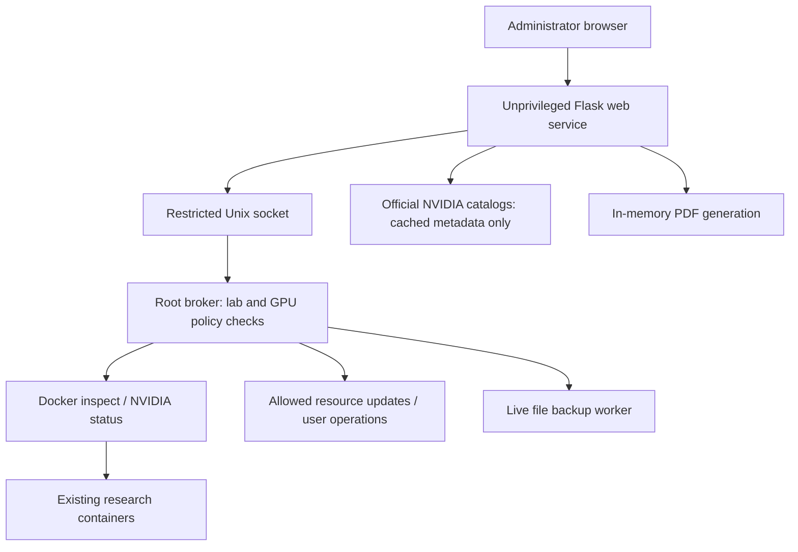

# Architecture

No Docker socket is mounted in the web service or researcher environments. The broker accepts a fixed action vocabulary; it does not accept shell snippets. `/etc/h200-console/policy.json` is root-owned and specifies the lab/GPU mutation boundary. Registration changes metadata, not container configuration.

Storage locations retain the `h200-console` name for migration compatibility. The product and installer do not require an H200 GPU. Current UI registration supports explicitly assigned single-GPU containers with bind mounts; all-GPU and multi-GPU imports are rejected until their resource mapping is implemented.

Status requests share a five-second cache and inspect containers in a single Docker invocation. Browser updates use existing DOM nodes, preserving active forms. Image tags use a fifteen-minute cache with stale-cache fallback. Live backups use a separate worker and do not pause the container.

## Languages

Add a JSON file under `app/locales`. Keys are canonical Korean source messages and values are localized strings. `Accept-Language` chooses a supported language; an authenticated session selection overrides it. Keep placeholders/units intact. Lab names and entered guide content are user-authored data, not automatically translated. PDF language is selected independently.
